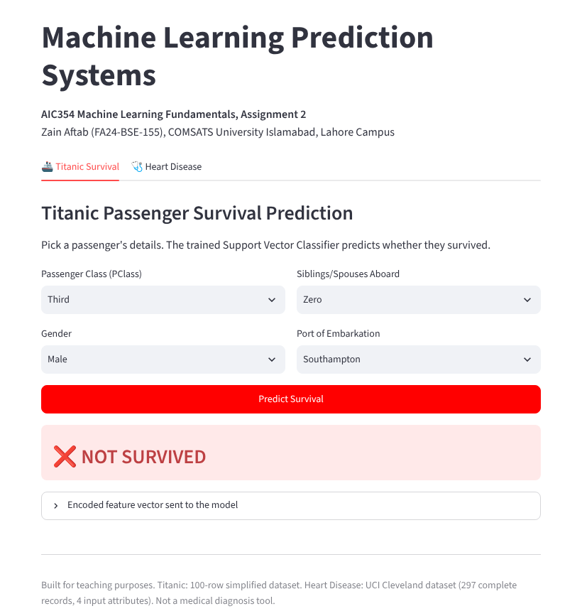

<div align="center">

# 🤖 End-to-End Machine Learning Systems: Titanic Survival & Heart Disease

Two complete machine learning systems, from raw data to a deployed web app: a **Titanic passenger survival predictor** and a **heart disease predictor**, both using a Support Vector Classifier and served together in one Streamlit app.

[](https://zain-aic354-ml-systems.streamlit.app)


### 🔗 Live demo: **https://zain-aic354-ml-systems.streamlit.app**



</div>

---

## Results

| Task | System | Data | Input attributes | Model | Test accuracy |
|---|---|---|---|---|---|
| 1 | Titanic Passenger Survival Prediction | 100-row Titanic sample | Passenger class, gender, siblings/spouses aboard, port of embarkation | SVC | **0.80** |
| 2 | Heart Disease Prediction | [UCI Heart Disease, Cleveland](https://archive.ics.uci.edu/dataset/45/heart+disease) (297 complete records) | Chest pain type, ST-segment slope, major vessels, thallium test result | SVC | **0.75** |

Both models: `SVC(gamma="auto", random_state=0)`, 80/20 train/test split (`random_state=0`), inputs and labels label-encoded.

## Method

Each task follows the same nine-step machine learning cycle in the notebook:

1. Import libraries
2. Load the sample data
3. Understand and pre-process the data (missing values, duplicates, value counts)
4. Feature extraction (choose the input attributes)
5. Label-encode inputs and outputs
6. **Training phase:** split 80/20, train the SVC, save the model with pickle
7. **Testing phase:** load the model, predict on the test set, accuracy, precision, recall, F1 and confusion matrix
8. **Application phase:** take a new passenger or patient from the user, encode it exactly like the training data, predict
9. **Feedback phase:** list limitations and possible improvements

## Web app

`streamlit-app/app.py` loads both trained models and offers two tabs:

- **Titanic Survival:** choose class, gender, siblings/spouses and port, then click *Predict Survival*
- **Heart Disease:** choose the four clinical attributes, then click *Predict Heart Disease*

Each prediction can show the encoded feature vector that was sent to the model. The heart disease tab is a teaching example only, not a medical diagnosis tool.

## Repository structure

```
aic354-ml-systems/
├── AIC354_Assignment2_Zain_Aftab_FA24-BSE-155.ipynb   # full notebook (also exported as .html and .pdf)
├── titanic/
│   ├── sample-data.csv                 # raw data (100 rows)
│   ├── training-data-encoded.csv       # encoded training split
│   ├── testing-data-encoded.csv        # encoded test split
│   ├── model-predictions.csv           # test-set predictions
│   ├── sample-data-encoded*.csv        # encoded full data and outputs
│   └── svc_trained_model.pkl           # trained model
├── heart_disease/
│   ├── processed.cleveland.data        # raw UCI data
│   └── ... same set of encoded files, predictions and trained model
├── streamlit-app/
│   ├── app.py                          # two-tab Streamlit app
│   ├── titanic_svc_trained_model.pkl
│   ├── heart_svc_trained_model.pkl
│   └── requirements.txt
└── requirements.txt                    # notebook + app dependencies
```

## Run locally

```bash
git clone https://github.com/ZainAftab-dev/aic354-ml-systems.git
cd aic354-ml-systems
pip install -r requirements.txt

# notebook
jupyter notebook          # open the .ipynb, then Kernel → Restart & Run All

# web app
streamlit run streamlit-app/app.py
```

Keep `scikit-learn==1.7.2` so the saved `.pkl` models load without version warnings.

## Deployment

Deployed on [Streamlit Community Cloud](https://share.streamlit.io) with main file `streamlit-app/app.py` and Python 3.11.

## Author

**Zain Aftab** (FA24-BSE-155), Section B, BS Software Engineering, COMSATS University Islamabad, Lahore Campus
AIC354 Machine Learning Fundamentals, Assignment 2 · Instructor: Dr. Rao Muhammad Adeel Nawab

[GitHub](https://github.com/ZainAftab-dev) · [LinkedIn](https://www.linkedin.com/in/zain-aftab-563727295/)

> See also: [diamond_price_model](https://github.com/ZainAftab-dev/diamond_price_model) (Assignment 3, regression with 10-fold cross validation).
